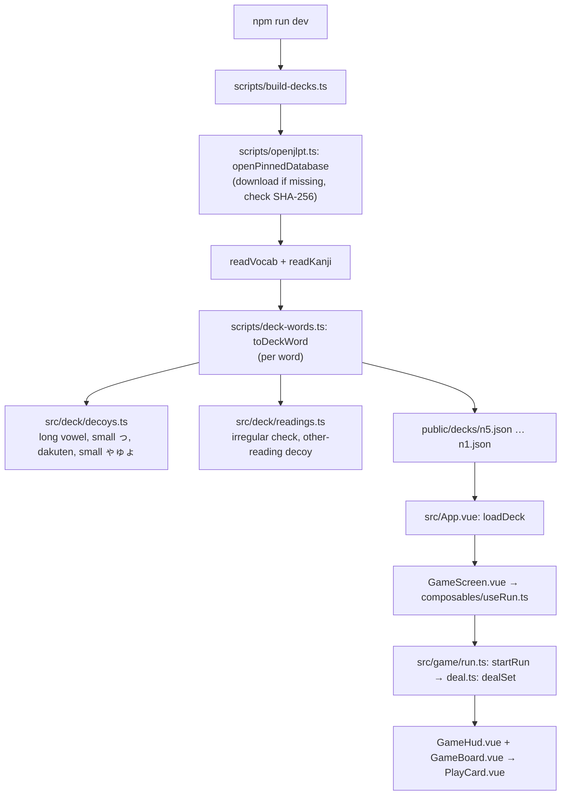
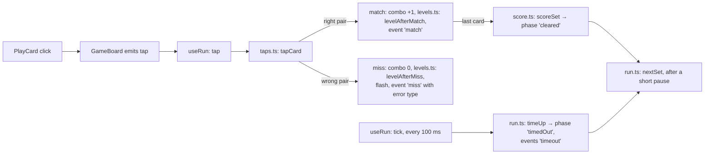

# juku-arcade: a guide to the code

For anyone reading the code for the first time. It covers what happens when
you run the game, the words the code uses, and where to change things.
Keep it in step with the code: a PR that makes it wrong fixes it.

## The flow, part 1: from `npm run dev` to a dealt board

1. **`npm run dev`** runs the deck build, then starts Vite.
2. **`scripts/openjlpt.ts: openPinnedDatabase`** finds `data/raw/openjlpt.sqlite`,
   downloading it from the pinned OpenJLPT commit if it's missing. It
   refuses to go on if the file's SHA-256 isn't the pinned one, because
   different data would make different decks.
3. **`readVocab`** and **`readKanji`** read the words (7,811) and kanji
   (2,383) out of SQLite with Node's built-in `node:sqlite`.
4. **`scripts/deck-words.ts: toDeckWord`** turns each word into a deck word:
   - kana-only words (これ) are dropped, because their reading is their
     spelling;
   - **`decoysFor`** builds one decoy per error type, using
     `src/deck/decoys.ts` and `src/deck/readings.ts: otherReadingDecoy`;
   - **`missChanceGuess`** gives the starting difficulty guess, using
     `readings.ts: isIrregularReading`.
5. **`scripts/build-decks.ts`** writes one JSON file per JLPT level to
   `public/decks/`. These files aren't committed.
6. In the browser, **`src/App.vue: loadDeck`** fetches `decks/n5.json` and
   mounts **`GameScreen.vue`**, which calls **`useRun`**.
7. **`src/game/run.ts: startRun`** builds the first state. It calls
   **`deal.ts: dealSet`**, which picks 5 words that share no spelling and
   no valid reading, and one decoy of the error type shown least so far.
   **`tags.ts: tagsByRank`** gives each word its +0.1× to +0.5× tag.
8. **`GameHud.vue`** shows the level, combo and timer, and
   **`GameBoard.vue`** shows the cards, each one a **`PlayCard.vue`**,
   styled by **`card-status.ts`**.

## The flow, part 2: one tap

1. A tap selects a card. A tap on a card of the other kind pairs the two
   (**`taps.ts: tapCard`**).
2. A right pair is a **match**. The combo goes up, and every 10 combo the
   level goes up (**`levels.ts: levelAfterMatch`**). If the word wasn't
   missed in this set, its tag joins the set's multiplier.
3. A wrong pair is a **miss**, counted against the word card in it. The
   combo resets, the level drops (from 5 straight to 1), and the right
   reading flashes. The event records whether the wrong reading was the
   decoy (and its error type) or another word's reading (a mix-up).
4. Matching the last word clears the set. **`score.ts: scoreSet`** works
   out chips × multiplier.
5. **`useRun`** ticks every 100 ms. When time runs out,
   **`run.ts: timeUp`** logs a timeout for each unmatched word (never a
   miss), resets the combo, drops the level, and shows the answers.
6. After a short pause, **`run.ts: nextSet`** deals the next set at the
   current level's time.

## The flow, part 3: pause and flip

1. **⏸ Pause** in **`GameHud.vue`** (or hiding the tab, or opening the
   About page) calls **`pause.ts: pause`**. The clock stops, and
   **`card-status.ts`** turns every card face down.
2. Tapping a face-down word card calls **`pause.ts: flipCard`**.
   **`CardBack.vue`** shows the word's reading, meanings, an example with
   furigana (**`FuriganaText.vue`**, parsing `{学校|がっこう}` markup), and
   each kanji's readings from the deck's kanji table, with the readings
   this word uses highlighted.
3. Flipping an unmatched card on the board is a **peek**. The word gets a 👁,
   scores nothing when matched (**`taps.ts: peekedMatch`**), and joins the
   comeback queue. Cards in **`MissedTray.vue`** are past misses, so flipping
   them is free.
4. **▶ Resume** calls **`pause.ts: resume`**, which moves the set's clock
   on by the time spent paused.
5. Missed and peeked words come back in the next set, up to 3 per set
   (**`run.ts: comebackWords`**, **`deal.ts: pickWords`**).

Every action appends a **`GameEvent`** (`events.ts`) with all of R6's
fields. They stay in memory until slice 3 stores them.

## Glossary

| Term | Meaning | Where |
|---|---|---|
| **Reading** | How a word is pronounced, written in kana: 学校 → がっこう | `DeckWord.reading` |
| **On-yomi / kun-yomi** | A kanji's Chinese-derived readings (ガク, shown in katakana) and native Japanese readings (まな.ぶ) | `KanjiReadings` in `readings.ts` |
| **Okurigana** | Kana written after a kanji as part of the word: the ぶ in 学ぶ. KANJIDIC2 marks it with a dot: まな.ぶ | `kunyomiForms` |
| **Stem form** | A verb's form inside compounds: 入る → 入り, in 入口 いりぐち | `STEM_FORM` in `readings.ts` |
| **Rendaku** | A sound that voices at the start of a compound's second part: 口 くち → 入口 いり**ぐ**ち | `withSoundChanges` |
| **Sokuon** | A small っ that doubles the next sound: 学 がく + 校 こう → が**っ**こう | `withSoundChanges`, `isPronounceable` |
| **Irregular reading** | A reading no combination of the kanji's readings makes, as in 今日 きょう or 大人 おとな. It feeds the difficulty guess | `isIrregularReading` |
| **Decoy** | The sixth reading card, which belongs to no word in the set. It's built to test one error type | `ReadingCard` with `wordId: null` |
| **Error type** | The kind of mistake a decoy tests: long vowel, small っ, dakuten, small ゃゅょ, other reading of the same kanji | `DECOY_TYPES` in `types.ts` |
| **Set** | One board: 5 words and 6 readings | `DealtSet` in `deal.ts` |
| **L2 rules** | No two cards in a set share a spelling or a valid reading, and the decoy is no word's valid reading | `canJoin`, `pickDecoy` |
| **Miss-chance guess** | The starting guess at how likely a word is to be missed, 0 to 1, before any play data | `missChanceGuess` |
| **Combo / level** | Correct matches in a row; every 10 raises the level (1–5), which shortens the set timer | `levels.ts` |
| **Clean match** | A match of a word that wasn't missed earlier in the same set. Only clean matches add their tag | `taps.ts: match` |
| **Tag** | A card's difficulty bonus (+0.1× to +0.5×), from its rank within the deck | `tags.ts` |
| **Chips × multiplier** | The set score: chips for clean matches and seconds left, times level × (1 + the tags added up) | `score.ts` |
| **Event** | One logged action with every R6 field, the raw material for the reports | `events.ts` |
| **Pause / flip** | Pausing stops the clock and turns cards face down; flipping shows a card's back | `pause.ts`, `CardBack.vue` |
| **Peek** | Flipping an unmatched card on the board: the word then scores nothing and comes back soon | `pause.ts: withPeek` |
| **Comeback** | A missed or peeked word dealt again in the next set | `comebacks.ts`, `run.ts: comebackWords` |
| **Missed tray** | This run's last 8 missed words, flippable while paused | `MissedTray.vue` |
| **Kanji note** | A kanji's readings, meanings and other words, carried in each deck for the card's back | `KanjiNote` in `types.ts`, `scripts/deck-kanji.ts` |
| **Pinned OpenJLPT** | One exact OpenJLPT build, fixed by commit and SHA-256, the same one Juku uses | `scripts/openjlpt.ts` |

## Where to change things

- **Add or change an error type:** add a generator to `src/deck/decoys.ts`,
  add the type to `DECOY_TYPES` in `src/deck/types.ts`, wire it into
  `decoysFor` in `scripts/deck-words.ts`, and add a test.
- **Change the difficulty guess:** edit `DIFFICULTY_GUESS` in
  `scripts/deck-words.ts`.
- **Move to a newer OpenJLPT build:** change `OPENJLPT_COMMIT` and
  `SQLITE_SHA256` in `scripts/openjlpt.ts`, run `npm run decks:report`,
  and compare it with `docs/spikes/slice-0-decks.md`.
- **Change what a deck file holds:** edit `DeckWord` in
  `src/deck/types.ts`. The script and the game both follow it.
- **Change the set rules:** edit `src/game/deal.ts`, and its specs in
  `tests/deal.test.ts`.
- **Tune the game (timer, levels, scoring, pauses):** edit
  `src/game/tuning.ts`. Every number the playtest may change is there.
- **Change what happens on a tap:** edit `src/game/taps.ts`; timeouts and
  dealing are in `src/game/run.ts`. Specs: `tests/run.test.ts`.
- **Change what a card's back shows:** edit `src/components/CardBack.vue`;
  the data comes from `scripts/deck-words.ts` and `scripts/deck-kanji.ts`.
- **Change pause or peek rules:** edit `src/game/pause.ts`. Specs:
  `tests/pause.test.ts`.
- **Add an event field:** add it to `GameEvent` and `makeEvent` in
  `src/game/events.ts`, and to `R6_FIELDS` in `tests/run.test.ts`.
- **Change how cards look:** edit `src/components/PlayCard.vue`. Every card
  is one.
