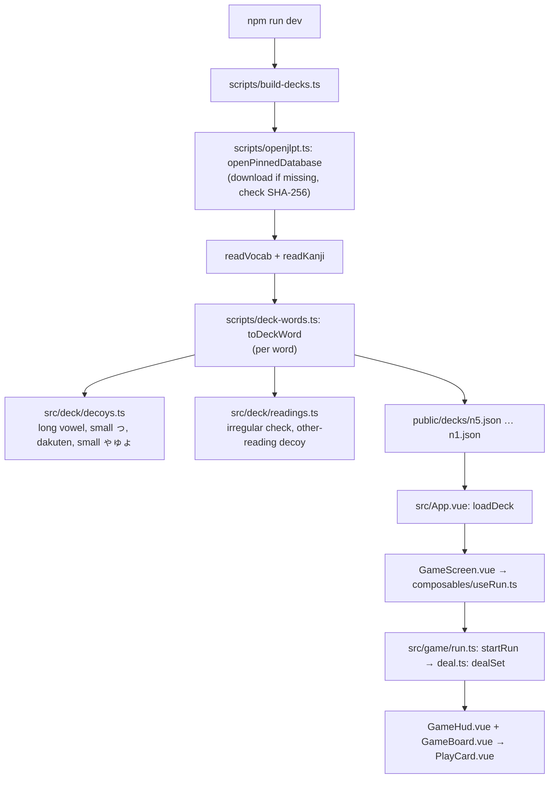
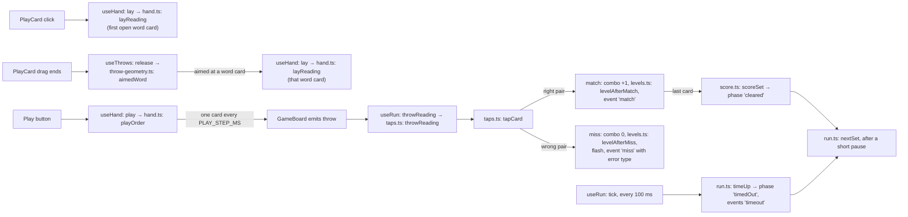

# juku-arcade: a guide to the code

For anyone reading the code for the first time. It covers what happens when
you run the game, the words the code uses, and where to change things.
Keep it in step with the code: a PR that makes it wrong fixes it.

## The flow, part 1: from `npm run dev` to a dealt board

1. **`npm run dev`** runs the deck build, then starts Vite.
2. **`scripts/openjlpt.ts: openPinnedDatabase`** finds `data/raw/openjlpt.sqlite`,
   downloading it from the pinned OpenJLPT commit if it's missing. It
   refuses to go on if the file's SHA-256 isn't the pinned one, because
   different data would make different decks.
3. **`readVocab`** and **`readKanji`** read the words (7,811) and kanji
   (2,383) out of SQLite with Node's built-in `node:sqlite`.
4. **`scripts/deck-words.ts: toDeckWord`** turns each word into a deck word:
   - kana-only words (これ) are dropped, because their reading is their
     spelling;
   - **`decoysFor`** builds one decoy per error type, using
     `src/deck/decoys.ts` and `src/deck/readings.ts: otherReadingDecoy`;
   - **`missChanceGuess`** gives the starting difficulty guess, using
     `readings.ts: isIrregularReading`.
5. **`scripts/build-decks.ts`** writes one JSON file per JLPT level to
   `public/decks/`. These files aren't committed.
6. In the browser, **`src/App.vue: loadDeck`** fetches `decks/n5.json` and
   mounts **`GameScreen.vue`**, which calls **`useRun`**.
7. **`src/game/run.ts: startRun`** builds the first state. It calls
   **`deal.ts: dealSet`**, which picks 5 words that share no spelling and
   no valid reading, and one decoy of the error type shown least so far.
   **`tags.ts: tagsByRank`** gives each word its +0.1× to +0.5× tag.
8. **`GameHud.vue`** shows the level, combo and timer, and
   **`GameBoard.vue`** shows the cards, each one a **`PlayCard.vue`**,
   styled by **`card-status.ts`**.

## The flow, part 2: lay out a hand, then play it

1. The player **lays out a hand**: a reading card for each word card. The
   reading cards are held in a fan under the word cards, which are
   numbered 1 to 5. Clicking a reading card (or pressing Enter on it)
   lays it for the first word card still open, from the left
   (**`hand.ts: layReading`**): it shifts up out of the fan with an aqua
   tag showing that word's number. Dragging it onto a word card, or
   flinging it at one, lays it for that word instead: while it's dragged
   the word card under it lights up (**`useThrows: trackDrag`**), and on
   release **`throw-geometry.ts: aimedWord`** picks the word card it was
   dropped on, or else the one it was heading for 0.15 s ahead. A card
   already laid for that word goes back down. Clicking a laid card takes
   it back. Nothing is checked yet.
2. Once every word card has a reading under it, **Play** lights up
   (**`hand.ts: isHandReady`**). Pressing it throws the laid cards at
   their words, left to right, one every `PLAY_STEP_MS`
   (**`useHand: play`**). Each throw goes through
   **`taps.ts: throwReading`**, so it scores exactly like a pair of taps.
   If the game pauses or the set ends mid-hand, the rest stay laid out.
3. A right pair is a **match**. The combo goes up, and every 10 combo the
   level goes up (**`levels.ts: levelAfterMatch`**). If the word wasn't
   missed in this set, its tag joins the set's multiplier.
4. A wrong pair is a **miss**, counted against the word card in it. The
   combo resets, the level drops (from 5 straight to 1), and the right
   reading flashes. The wrong card springs back to the hand, to be laid
   again. The event records whether the wrong reading was the
   decoy (and its error type) or another word's reading (a mix-up).
5. Matching the last word clears the set. **`score.ts: scoreSet`** works
   out chips × multiplier.
6. **`useRun`** ticks every 100 ms. When time runs out,
   **`run.ts: timeUp`** logs a timeout for each unmatched word (never a
   miss), resets the combo, drops the level, and shows the answers.
7. After a short pause, **`run.ts: nextSet`** deals the next set at the
   current level's time, and the hand starts empty again.

## The flow, part 3: pause and flip

1. **⏸ Pause** in **`GameHud.vue`** (or hiding the tab, or opening the
   About page) calls **`pause.ts: pause`**. The clock stops, and
   **`card-status.ts`** turns every card face down.
2. Tapping a face-down word card calls **`pause.ts: flipCard`**.
   **`CardBack.vue`** shows the word's reading, meanings, an example with
   furigana (**`FuriganaText.vue`**, parsing `{学校|がっこう}` markup), and
   each kanji's readings from the deck's kanji table, with the readings
   this word uses highlighted.
3. Flipping an unmatched card on the board is a **peek**. The word gets a 👁,
   scores nothing when matched (**`taps.ts: peekedMatch`**), and joins the
   comeback queue. Cards in **`MissedTray.vue`** are past misses, so flipping
   them is free.
4. **▶ Resume** calls **`pause.ts: resume`**, which moves the set's clock
   on by the time spent paused.
5. Missed and peeked words come back in the next set, up to 3 per set
   (**`run.ts: comebackWords`**, **`deal.ts: pickWords`**).

## The flow, part 4: memory across visits

1. **`App.vue`** loads the settings (**`memory/storage.ts: loadSettings`**).
   With none, **`SetupScreen.vue`** asks for a level and an optional class
   code. Then it loads the event log (**`loadEvents`**) and the level's deck.
2. **`useRun`** builds the review engine,
   **`memory/review-engine.ts: createLocalEngine`**. It rebuilds each
   word's memory from the log (**`word-memory.ts: deriveMemory`**):
   misses and peeks are wrong answers, clean matches are right ones, and
   **`leitner.ts: afterAnswer`** moves the word between boxes (ported from
   Juku).
3. Before each deal, the engine picks the pool
   (**`daily-deck.ts: poolForNextSet`**): today's due reviews and new words
   until the daily deck is cleared, then weak words plus one new word. It
   also gives fresh learned tags (**`difficulty.ts: learnedTags`**).
4. After every change, **`useRun`** hands new events to the engine and to
   IndexedDB (**`appendEvents`**), saves new bests, and refreshes
   **`DailyBar.vue`**: today's deck, words known, and days played.

## The flow, part 5: the daily check-up and the export

1. When the game starts, **`App.vue: offerCheckUp`** asks
   **`memory/check-up-questions.ts: pickQuestions`** for today's questions,
   once a day (`checkUpOfferedDay` in settings):
   - **before:** the next new words, not yet played;
   - **after:** words checked before, first played at least a day ago;
   - **held back:** words checked before and kept out of play since.
2. **`CheckUpScreen.vue`** asks each question: 4 readings
   (**`check-up.ts: optionsFor`**: similar readings from other words, not the
   game's decoys) and 8 seconds. **`checkUpEvent`** logs each answer as
   `check_up_right` or `check_up_wrong`, with its role. A timeout is wrong.
3. Answering a before question decides whether the word is held back:
   **`check-up.ts: isHeldBack`** hashes the player and word IDs, so 1 word in
   3 is held back, the same way every time. A held word stays out of the
   daily deck for 3 days (**`isOnHold`**, used by **`daily-deck.ts`**).
4. Check-up answers update only the check-up history
   (**`applyCheckUp`**, kept in `Memory.checkUps`), never the review schedule
   or difficulty.
5. **Settings → Export my data** (**`memory/export.ts`**) downloads all events
   as an anonymous JSON file. Slice 5b's report script reads these files.

## The flow, part 6: the reports (outside the app)

1. **`npm run report -- <folder of exports> [output folder]`** runs
   **`scripts/build-reports.ts`**.
2. **`scripts/report/load.ts: readExportFolder`** merges the files, drops
   duplicate events by `event_id`, and counts data problems (unknown format
   versions, clock jumps).
3. **`report/measurement.ts: measure`** works out the headline: after minus
   held-back accuracy, a 95% bootstrap interval resampling players, and the
   verdict from the plan's fixed rules.
4. **`report/class-report.ts`** lists the most-missed words (by share of
   answers missed, at least 5 learners), common confusions (decoys and
   mix-ups apart), error types per time shown (from `deal` events), and
   learners who may need help.
5. **`report/learner-report.ts`** writes an ability report per anonymous
   player, reusing the app's `deriveMemory` for "words known".
6. **`report/play-measures.ts`** works out the game measures from events
   alone: S1 coming back, S4 loop balance (timeouts and misses per level,
   and quitting after a 5→1 drop), S5 peeks, S6 check-up uptake.
7. **`report/deck-measures.ts`** works out the two that need the decks in
   `public/decks`: S2 replays each player's events day by day through the
   app's own `dailyProgress`, and S3 scores the starting guess against the
   learned miss chance on each later answer, predicted only from earlier
   ones. Each player's deck is the level in their latest export.
8. **`report/render.ts`** writes `measurement-report.md`, `class-report.md`,
   `ability-reports.md` and `events.csv`; **`report/render-play.ts`**
   writes `play-report.md`, with phase 3's reading of each measure.

**`report/simulate.ts`** makes simulated players with a planted truth. The
specs use them to check the reports find what's there and don't invent what
isn't, and `npm run power` uses them to show how often a real effect is
detected at each class size.

## The look and wellbeing

- **The karuta table (D30)** lives in `src/style.css`: colour tokens for
  the palette (D33: `lacquer` navy table, `steel` blue, `aqua`
  highlights, `washi` paper, `crimson` accent, `sumi` ink), two fonts (a
  pixel font for English, `public/fonts/balatro/`, and DotGothic16 for
  Japanese, from the `@fontsource/dotgothic16` package; decision D31), and
  two textures made of CSS gradients (`.washi` paper, `.card-back`).
  Behind everything, `TableBackground.vue` shows marbled navy bands that
  warp and spiral in a 19-second loop (D35). A WebGL shader draws them
  (`background/swirl-shader.ts`) on a canvas a sixth of the window's
  size, stretched to fill it, about 30 times a second.
- **Animation** uses Motion for Vue's small bundle (`LazyMotion` with
  `domAnimation` in `App.vue`, and `m.*` elements). `MotionConfig` follows the
  system's reduce-motion setting. `components/card-motion.ts` says how
  each card moves: a new set comes off the deck face down, one card after
  another, turning face up as it flies; pausing turns every card over in
  a wave (each card draws a front and a back, `PlayCard.vue`); a held
  card lifts, a laid card shifts up out of the fan, and a matched
  reading card flies on, spinning, to its word card, hits it, and both
  fall over. Dragging uses Motion's drag, so `App.vue` loads the `domMax`
  bundle. Every card sits in a slot the size of the card that never moves
  (`composables/useTableSlots.ts`), so the slots can be measured before
  any card is drawn: `useDeal.ts` measures where the deck is from each
  slot, and `useThrows.ts` how far a thrown card flies (before the board
  redraws). A card moves by being drawn away from its own slot. The fan
  is a fixed turn and drop on each reading card's slot (`fanStyle` in
  `GameBoard.vue`). Inside its slot every card floats: a CSS animation
  (`float` in `style.css`) bobs and sways it, each card out of step with
  the next (`floatStyle`).
  Every card also tilts in 3D toward the mouse while it's over the card
  (`composables/useCardTilt.ts`, maths in `components/card-tilt.ts`), on
  a layer inside the card so it adds to whatever Motion is doing.
  `GameHud.vue` pops the combo and level.
  The score total counts up with a short `requestAnimationFrame` loop in
  `ScoreBreakdown.vue`, which is lighter than Motion's full engine.
- **Buttons and panels** are pixel art too (D36): `.pixel-panel` and
  `.pixel-button` in `style.css` give them the cards' stepped corners, a lit
  top edge and a shaded bottom edge. Every button outside the cards is a
  `PixelButton.vue`, which also plays a click animation: its `--wipe`
  colour sweeps in from both edges in small steps, meets in the middle,
  then fades, within 0.3 s.
- **Cards** are pixel-art karuta cards (D32): `CardFrame.vue` draws the
  body every card shares (a hard shadow, a thick frame with stepped pixel
  corners, and washi paper, or the patterned back when face down), and `PlayCard.vue` puts the text on it. One "pixel" is a share
  of the card's width (`--pixel` in `style.css`), so the art scales with
  the card. Reading cards are written top to bottom, like karuta's grab
  cards; word cards keep their kanji across. Word cards have a crimson
  frame and reading cards a steel-blue one. The frame turns white when a
  dragged card aims at it, crimson when wrong and aqua for the right
  answer. A suit mark sits in two corners (言 on word cards, 音 on reading
  cards), and the deck's JLPT level (N5 to N1) in the bottom-left. The text sizes itself to the card with container
  units, and a reading longer than 6 kana goes in two columns.
- **Sound and the combo (feeling involved):** every move gets an answer.
  `sound/sfx.ts` plays them. The card sounds are recordings from Kenney's
  Casino Audio pack (CC0, in `public/sounds/` with its licence): a
  shuffle when a set is dealt, the shuffle's first flick when a card is
  picked, and a slap when it lands. The rest are made in code with ZzFX (a tiny MIT
  synth): a click when a held card is over a word card, a swish when
  it's thrown, a chime when it hits,
  a buzz on a miss, an arpeggio on a level up. Each match in a combo
  chimes the next note of a pentatonic scale (`comboPitch`), so a streak
  climbs a tune. `composables/useGameFeel.ts` watches the run and plays
  these when the thrown card lands, and drives `ComboMeter.vue`: the
  combo between the two rows, growing and warming (aqua from 5, crimson
  from 10, with いいね！, すごい！, さいこう！). A glow behind the cards
  (`.table-glow`) brightens with the combo and the table jolts on each
  hit. A lost streak of 3 or more drops away in crimson. The 🔊 button
  in the side panel mutes it all, remembered in this browser. ZzFX is
  loaded on the first sound, because browsers only allow sound after the
  player has touched the page.
- **Layout (desktop only):** the school plays on laptops and desktops, so
  `GameScreen.vue` always puts a side panel (`DailyBar`, `GameHud`,
  `ScoreBreakdown`) beside the table: 5 numbered word cards, the combo
  and the Play button, then the hand of 6 reading cards held in a fan,
  next to the deck. The game fills the window: the root font size grows with the
  window's width (`html` in `style.css`), and each card row in
  `GameBoard.vue` sets its cards' height as a share of the window's
  height (`--card-height`), so a set fits without scrolling.
- **Wellbeing:** `useRun` counts play time while the game isn't paused.
  `game/wellbeing.ts` decides when to show `WellbeingNudge.vue` (15 and 30
  minutes in one sitting), and whether today's play has reached the cap set
  by `VITE_DAILY_CAP_MINUTES` (see `.env.example`; unset means no cap).

Every action appends a **`GameEvent`** (`events.ts`) with all of R6's
fields. They stay in memory until slice 3 stores them.

## Glossary

| Term | Meaning | Where |
|---|---|---|
| **Reading** | How a word is pronounced, written in kana: 学校 → がっこう | `DeckWord.reading` |
| **On-yomi / kun-yomi** | A kanji's Chinese-derived readings (ガク, shown in katakana) and native Japanese readings (まな.ぶ) | `KanjiReadings` in `readings.ts` |
| **Okurigana** | Kana written after a kanji as part of the word: the ぶ in 学ぶ. KANJIDIC2 marks it with a dot: まな.ぶ | `kunyomiForms` |
| **Stem form** | A verb's form inside compounds: 入る → 入り, in 入口 いりぐち | `STEM_FORM` in `readings.ts` |
| **Rendaku** | A sound that voices at the start of a compound's second part: 口 くち → 入口 いり**ぐ**ち | `withSoundChanges` |
| **Sokuon** | A small っ that doubles the next sound: 学 がく + 校 こう → が**っ**こう | `withSoundChanges`, `isPronounceable` |
| **Irregular reading** | A reading no combination of the kanji's readings makes, as in 今日 きょう or 大人 おとな. It feeds the difficulty guess | `isIrregularReading` |
| **Decoy** | The sixth reading card, which belongs to no word in the set. It's built to test one error type | `ReadingCard` with `wordId: null` |
| **Error type** | The kind of mistake a decoy tests: long vowel, small っ, dakuten, small ゃゅょ, other reading of the same kanji | `DECOY_TYPES` in `types.ts` |
| **Set** | One board: 5 words and 6 readings | `DealtSet` in `deal.ts` |
| **L2 rules** | No two cards in a set share a spelling or a valid reading, and the decoy is no word's valid reading | `canJoin`, `pickDecoy` |
| **Miss-chance guess** | The starting guess at how likely a word is to be missed, 0 to 1, before any play data | `missChanceGuess` |
| **Combo / level** | Correct matches in a row; every 10 raises the level (1–5), which shortens the set timer | `levels.ts` |
| **Clean match** | A match of a word that wasn't missed earlier in the same set. Only clean matches add their tag | `taps.ts: match` |
| **Tag** | A card's difficulty bonus (+0.1× to +0.5×), from its rank within the deck | `tags.ts` |
| **Chips × multiplier** | The set score: chips for clean matches and seconds left, times level × (1 + the tags added up) | `score.ts` |
| **Event** | One logged action with every R6 field, the raw material for the reports | `events.ts` |
| **Pause / flip** | Pausing stops the clock and turns cards face down; flipping shows a card's back | `pause.ts`, `CardBack.vue` |
| **Peek** | Flipping an unmatched card on the board: the word then scores nothing and comes back soon | `pause.ts: withPeek` |
| **Comeback** | A missed or peeked word dealt again in the next set | `comebacks.ts`, `run.ts: comebackWords` |
| **Missed tray** | This run's last 8 missed words, flippable while paused | `MissedTray.vue` |
| **Kanji note** | A kanji's readings, meanings and other words, carried in each deck for the card's back | `KanjiNote` in `types.ts`, `scripts/deck-kanji.ts` |
| **Leitner box** | Boxes 1–5; a word waits 1, 2, 4, 8 or 16 days before it's due again. Wrong goes to box 1 | `memory/leitner.ts` |
| **Daily deck** | Today's reviews due plus 10 new words; clearing it ticks the day | `memory/daily-deck.ts` |
| **Endless play** | After the daily deck: weak words plus one new word per set | `poolForNextSet` |
| **Learned miss chance** | (misses + 5 × guess) / (attempts + 5): the guess, corrected by the player's own record | `memory/difficulty.ts` |
| **Word known** | Answered right on 2 separate days (Juku's LE1 rule) | `leitner.ts: CORRECT_DAYS_TO_KNOW` |
| **Review engine** | The interface the game asks for words and progress; shaped like Juku's API so Juku can replace it | `memory/review-engine.ts` |
| **Combo meter / heat** | The combo shown between the card rows, and the glow behind the cards that warms with it | `ComboMeter.vue`, `useGameFeel.ts`, `.table-glow` in `style.css` |
| **ZzFX** | A tiny library that synthesises sound effects from a list of numbers | `sound/sfx.ts` |
| **Hand / laid card** | The 6 reading cards held in a fan. A laid card is one the player picked for a word card: it shifts up with that word's number (1 to 5) until Play | `game/hand.ts`, `useHand.ts` |
| **Play** | Throwing the laid-out hand at the word cards, left to right, one card at a time | `useHand.ts: play` |
| **Throw** | A laid reading card flying at its word card; a right pair spins on and knocks the word card down. Dragging or flinging a card at a word card lays it there | `throw-geometry.ts`, `useThrows.ts`, `card-motion.ts` |
| **Deck / deal** | The face-down stack beside the hand; each set's cards fly off it one after another | `CardDeck.vue`, `useDeal.ts`, `card-motion.ts: dealtFrom` |
| **Slot** | The fixed place a card sits in; cards move by being drawn away from it | `useTableSlots.ts` |
| **Washi / hanko** | Japanese paper (the card face) and a seal stamp (the crimson difficulty tag) | `style.css`, `PlayCard.vue` |
| **Nudge / daily cap** | A dismissible suggestion to stop after 15 and 30 minutes; a school-set daily limit for minors | `game/wellbeing.ts` |
| **Check-up roles** | before (first check, before play), after (re-check after play), held back (re-check without play): the measurement plan's three groups | `memory/check-up.ts` |
| **Held back** | 1 word in 3, chosen by hash, kept out of play for 3 days after its first check: the control group | `isHeldBack`, `isOnHold` |
| **Export** | The browser's event log as an anonymous JSON file the player chooses to share | `memory/export.ts` |
| **Play effect** | After-accuracy minus held-back accuracy, in percentage points: the headline | `report/measurement.ts` |
| **Bootstrap interval** | The range the play effect would likely fall in, found by resampling players 10,000 times | `bootstrapInterval` |
| **Deal event** | Logged for every set, with the error type its decoy tests, so error rates can be per time shown | `run.ts: dealEvent` |
| **Pinned OpenJLPT** | One exact OpenJLPT build, fixed by commit and SHA-256, the same one Juku uses | `scripts/openjlpt.ts` |

## Where to change things

- **Add or change an error type:** add a generator to `src/deck/decoys.ts`,
  add the type to `DECOY_TYPES` in `src/deck/types.ts`, wire it into
  `decoysFor` in `scripts/deck-words.ts`, and add a test.
- **Change the difficulty guess:** edit `DIFFICULTY_GUESS` in
  `scripts/deck-words.ts`.
- **Move to a newer OpenJLPT build:** change `OPENJLPT_COMMIT` and
  `SQLITE_SHA256` in `scripts/openjlpt.ts`, run `npm run decks:report`,
  and compare it with `docs/spikes/slice-0-decks.md`.
- **Change what a deck file holds:** edit `DeckWord` in
  `src/deck/types.ts`. The script and the game both follow it.
- **Change the set rules:** edit `src/game/deal.ts`, and its specs in
  `tests/deal.test.ts`.
- **Tune the game (timer, levels, scoring, pauses):** edit
  `src/game/tuning.ts`. Every number the playtest may change is there.
- **Change what happens on a tap:** edit `src/game/taps.ts`; timeouts and
  dealing are in `src/game/run.ts`. Specs: `tests/run.test.ts`.
- **Change how a hand is laid out or played:** the rules (which slot a
  click fills, when Play is ready, the play order) are in
  `src/game/hand.ts` (specs: `tests/hand.test.ts`); the time between
  throws is `PLAY_STEP_MS` in `composables/useHand.ts`.
- **Change what a card's back shows:** edit `src/components/CardBack.vue`;
  the data comes from `scripts/deck-words.ts` and `scripts/deck-kanji.ts`.
- **Change pause or peek rules:** edit `src/game/pause.ts`. Specs:
  `tests/pause.test.ts`.
- **Change the review schedule:** edit `memory/leitner.ts`. Specs:
  `tests/memory.test.ts`.
- **Change the daily deck or endless mix:** edit `memory/daily-deck.ts`; its
  numbers (10 new words a day, the endless pool) are in `game/tuning.ts`.
- **Change what's saved in the browser:** edit `memory/storage.ts`. Bump the
  Dexie version if the stores change.
- **Change colours, fonts or textures:** edit the tokens and classes in
  `src/style.css`.
- **Change a button's colours or its click wipe:** `COLOURS` in
  `components/PixelButton.vue` (the wipe's timing is `@keyframes wipe` in
  `style.css`).
- **Change an animation:** card motion is in `components/card-motion.ts`
  (`THROW_S` and `FALL_S` time the throw, `THROW_TURNS` its spin,
  `DEAL_STAGGER_S` the time between dealt cards, `FLIP_SPRING` and
  `FLIP_STAGGER_S` the pause flip, `MAX_TILT_DEG` in `card-tilt.ts` how far a
  card leans toward the mouse, `HELD_POSE` in `PlayCard.vue` a held card);
  the combo and level pops are in `GameHud.vue`.
- **Change a sound:** edit its numbers in `SOUNDS` in `sound/sfx.ts`
  (the comment there names each one), or point it at a different file in
  `RECORDINGS` (files live in `public/sounds/`). The combo's tune is
  `COMBO_STEPS`.
- **Change how the combo builds:** the steps, praise and colours are
  `TIERS` in `ComboMeter.vue`; the glow's brightest combo is
  `FULL_HEAT_COMBO` and the jolt is `SHAKE_*` in `GameBoard.vue`.
- **Change how forgiving a fling is:** `AIM_AHEAD_S` in
  `components/throw-geometry.ts`.
- **Change how big the game is:** the `html` font size in `style.css`, and
  `--card-height` on each row in `GameBoard.vue` (word cards, hand, deck);
  the fan is `FAN_TURN_DEG`, `FAN_DROP_PX` and `HAND_OVERLAP` there, and
  the float is `FLOAT` and `FLOAT_*_S`. The table's swirl: its colours
  (`DARK_RGB`, `LIGHT_RGB`), loop length (`SWIRL_LOOP_MS`) and band shapes
  are in `background/swirl-shader.ts`; its resolution and frame rate are
  `SHRINK` and `FRAME_MS` in `TableBackground.vue`.
- **Set a daily cap for a school:** set `VITE_DAILY_CAP_MINUTES` in `.env`
  before building. Nudge times are `NUDGE_MINUTES` in `game/wellbeing.ts`.
- **Change the check-up (questions, options, timer, hold):** the numbers are
  at the top of `memory/check-up.ts`; question picking is in
  `memory/check-up-questions.ts`. Specs: `tests/check-up.test.ts`.
- **Change the export format:** edit `memory/export.ts` and bump
  `EXPORT_FORMAT_VERSION`.
- **Change a report's rules (thresholds, minimum learners):** the constants
  are at the top of `scripts/report/class-report.ts` and `measurement.ts`.
  Specs: `tests/report.test.ts`, run on simulated players.
- **Change a play report threshold (S3's 5%, S4's 40% and 30%, S6's
  30%):** the constants at the top of `scripts/report/render-play.ts`.
  Specs: `tests/play-report.test.ts`, on hand-built events.
- **Deploy or tune for the playtest:** `docs/playtest.md`.
- **Add an event field:** add it to `GameEvent` and `makeEvent` in
  `src/game/events.ts`, and to `R6_FIELDS` in `tests/run.test.ts`.
- **Change how cards look:** edit `src/components/PlayCard.vue`. Every card
  is one.
