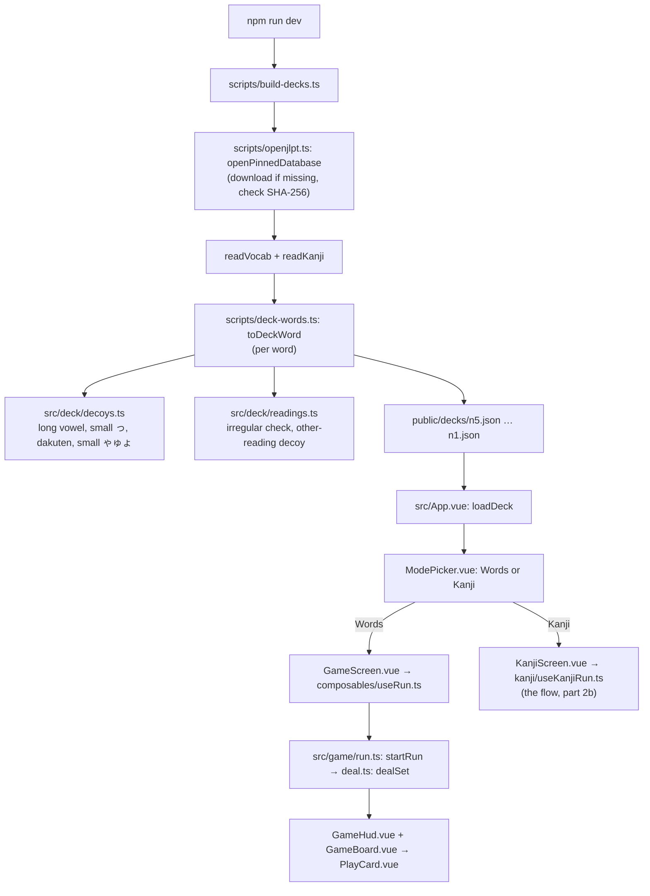
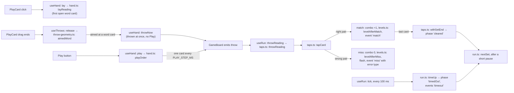
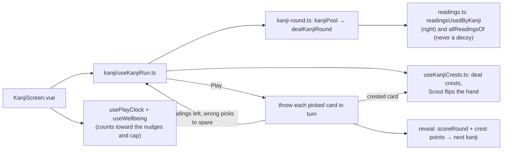
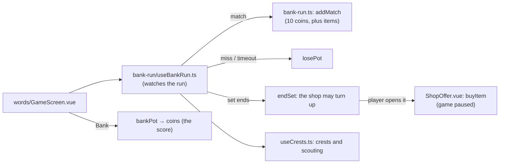
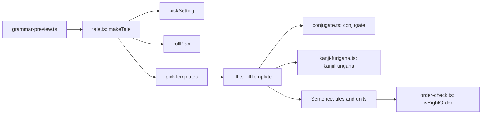

# juku-arcade: a guide to the code

For anyone reading the code for the first time. It covers what happens when
you run the game, the words the code uses, and where to change things.
Keep it in step with the code: a PR that makes it wrong fixes it.

## The flow, part 1: from `npm run dev` to a dealt board

1. **`npm run dev`** runs the deck build, then starts Vite.
2. **`scripts/openjlpt.ts: openPinnedDatabase`** finds `data/raw/openjlpt.sqlite`,
   downloading it from the pinned OpenJLPT commit if it's missing. It
   refuses to go on if the file's SHA-256 isn't the pinned one, because
   different data would make different decks.
3. **`readVocab`** and **`readKanji`** read the words (7,811) and kanji
   (2,383) out of SQLite with Node's built-in `node:sqlite`.
4. **`scripts/deck-words.ts: toDeckWord`** turns each word into a deck word:
   - kana-only words (これ) are dropped, because their reading is their
     spelling;
   - **`decoysFor`** builds one decoy per error type, using
     `src/deck/decoys.ts` and `src/deck/readings.ts: otherReadingDecoy`;
   - **`missChanceGuess`** gives the starting difficulty guess, using
     `readings.ts: isIrregularReading`.
5. **`scripts/build-decks.ts`** writes one JSON file per JLPT level to
   `public/decks/`. These files aren't committed.
6. In the browser, **`src/App.vue: loadDeck`** fetches `decks/n5.json` and
   mounts **`GameScreen.vue`**, which calls **`useRun`**.
7. **`src/game/run.ts: startRun`** builds the first state. It calls
   **`deal.ts: dealSet`**, which picks 5 words that share no spelling and
   no valid reading, and one decoy of the error type shown least so far.
   **`tags.ts: tagsByRank`** gives each word a difficulty tag, logged with
   its events for the reports (it no longer changes the score, D46).
8. **`GameHud.vue`** shows the level, combo and timer, and
   **`GameBoard.vue`** shows the cards, each one a **`PlayCard.vue`**,
   styled by **`card-status.ts`**.

## The flow, part 2: lay out a hand, then play it

1. The player plays a reading card in one of two ways (D48):
   - **Click to lay out a hand.** Clicking a reading card (or pressing
     Enter on it) lays it for the first word card still open, from the
     left (**`hand.ts: layReading`**): it shifts up out of the row with an
     aqua tag showing that word's number, and the word card shows the same
     tag, with the reading in its label underneath. Clicking a laid card
     takes it back. Nothing is checked until Play. A press that moves less
     than `TAP_SLOP_PX` still counts as a click (**`throw-geometry.ts:
     isDrag`**), so a wobbly click isn't lost.
   - **Drag to throw at once.** Dragging a card onto a word card, or
     flinging it at one, throws it straight away, with no Play: while
     it's dragged the word card under it lights up (**`useThrows:
     trackDrag`**), and on release **`throw-geometry.ts: aimedWord`**
     picks the word card it was dropped on, or else the one it was
     heading for 0.15 s ahead. **`useHand: throwNow`** takes the card out
     of the hand (and a card laid for that word goes back down) and
     throws it.
2. Once every word card has a reading under it, **Play** lights up
   (**`hand.ts: isHandReady`**). Pressing it throws the laid cards at
   their words, left to right, one every `PLAY_STEP_MS`
   (**`useHand: play`**). Each throw goes through
   **`taps.ts: throwReading`**, so it scores exactly like a pair of taps.
   If the game pauses or the set ends mid-hand, the rest stay laid out.
3. A right pair is a **match**. The combo goes up, and every 10 combo the
   level goes up (**`levels.ts: levelAfterMatch`**), and the bank run adds
   coins to its pot (part 2c).
4. A wrong pair is a **miss**, counted against the word card in it. The
   combo resets, the level drops (from 5 straight to 1), and the right
   reading flashes. The wrong card springs back to the hand, to be laid
   again. The event records whether the wrong reading was the
   decoy (and its error type) or another word's reading (a mix-up).
5. Matching the last word clears the set (**`taps.ts: withSetEnd`**).
   There's no set score any more: banked coins are the score (D46).
6. **`useRun`** ticks every 100 ms. When time runs out,
   **`run.ts: timeUp`** logs a timeout for each unmatched word (never a
   miss), resets the combo, drops the level, and shows the answers.
7. After a short pause, **`run.ts: nextSet`** deals the next set at the
   current level's time, and the hand starts empty again.

## The flow, part 2b: kanji mode

Each time the game opens (after the daily check-up), and from "Change
mode", **`ModePicker.vue`** offers Words or Kanji (D37). Kanji mode is
practice: it logs nothing and changes no reviews. Beside the choice, a
leaderboard (**`LeaderboardPanel.vue`**, **`leaderboard/leaderboard.ts`**),
drawn like an arcade high-score table, ranks your best score among
sample players until real scores can be shared (D47), 8 to a page, with
Back and Next to see the rest.

1. **`kanji-round.ts: kanjiPool`** works out, once per deck, the readings
   each kanji has in the level's words (**`readings.ts:
   readingsUsedByKanji`**). Readings show okurigana in brackets, まな(ぶ).
2. **`dealKanjiRound`** picks a kanji not shown recently, more often if it
   has several readings, and deals 8 cards: all its readings, plus readings
   of other kanji that the dictionary doesn't list for it.
3. **`KanjiBoard.vue`** shows the kanji and its meanings over an overlapping row of the 8
   readings. Clicking one picks it (it lifts) or puts it back.
4. **Crests** (D42): each round may hide a gold koban or purple omikuji
   on one right reading and a black curse on one wrong reading
   (**`kanji-crests.ts: dealKanjiCrests`**). **Scout**
   (**`KanjiScoutPanel.vue`**, **`useKanjiCrests: toggleScout`**) flips
   the hand over to show them. After that, a crested card's back and
   front frame stay in the crest's colour until the round ends
   (**`CardFrame.vue`**, `tint`). A run starts with 2 scouts and earns 1
   per perfect round, up to 3.
5. **Play** (**`useKanjiRun: play`**) throws the picked cards at the kanji
   in turn. A right one hits and dissolves, the kanji jolts, and the combo
   builds; a wrong one shakes, its frame goes dark, and it stays on the
   table, out of play. The player picks and plays again until every right
   reading is found or they've made three wrong picks (**`kanji-round.ts:
   isRoundOver`**, `MAX_WRONG_PICKS`, D45); three squares by the Play
   button count the wrong picks left. A crested card
   pays as it lands (**`crestBonus`**): a koban doubles that card's
   points, an omikuji adds 5 to 15, a curse takes 10.
6. When the round is over, the right readings left in the hand light up aqua (✓),
   **`scoreRound`** adds the points (a bonus for a perfect round) and the
   crests' points (the score never drops below 0), and a new kanji is
   dealt off the deck.
7. **`usePlayClock`** counts the play toward the nudges and the school's
   daily cap with the same tick as word mode (**`wellbeing.ts:
   tickPlayClock`**), and **`WellbeingGate.vue`** shows the same screens.

## The flow, part 2c: the bank run (word mode)

Word mode plays as an endless push-your-luck run (D44, D46). Every match
adds the same coins to an unbanked **pot**; banking it moves the coins to
your **coins**, which are your score, and ends the combo; a miss or a
timeout loses the pot. There are no rounds and no game over.

1. **`words/GameScreen.vue`** starts **`useBankRun`** beside the word run
   (`useRun`). It watches the run's state: a new match calls
   **`bank-run.ts: addMatch`**, which adds `COINS_PER_MATCH` to the pot
   whatever the combo (**`coinsForMatch`**; items can add more), and a
   broken combo calls **`losePot`**.
2. **Bank** (**`components/bank-run/BankPanel.vue`**) calls **`bankPot`**:
   the pot goes to your coins, the score, and `useRun: endCombo` ends the
   combo. The panel shows the pot at the top and the score at the bottom.
3. After each set, **`endSet`** may bring the shop for the next set
   (`SHOP_CHANCE`, a 1 in 3 roll; never two sets running). Its button
   appears in the panel; the shop never opens by itself.
4. Opening it (**`useBankRun: openShop`**) pauses the game. In the shop
   (**`ShopOffer.vue`**), your coins buy items (**`items.ts`**,
   **`buyItem`**) that bend the risk: more coins per match, half the pot
   kept on a miss, a bonus for banking, interest on savings. Buying
   lowers your score now for faster coins later. Leaving it, or resuming
   with Esc, closes it until a later set brings it back.
5. **Crests** (**`useCrests.ts`**, **`crests.ts: dealCrests`**) hide on a
   few word cards each set; **Scout** pauses the game to show them. A
   koban doubles a match's coins, an omikuji gives a gift, and a curse
   costs banked coins when missed. Scouts refill when the shop turns up.
6. The best score reached is kept in this browser (`useBankRun:
   readBestScore`), for the stats page and the leaderboard.

## The flow, part 3: pause and flip

1. **⏸ Pause** in **`GameHud.vue`**, or the Esc key (**`usePauseKey.ts`**) (or hiding the tab, or opening the
   About page) calls **`pause.ts: pause`**. The clock stops, and
   **`card-status.ts`** turns every card face down.
2. Tapping a face-down word card calls **`pause.ts: flipCard`**.
   **`CardBack.vue`** shows the word's reading, meanings, an example with
   furigana (**`FuriganaText.vue`**, parsing `{学校|がっこう}` markup), and
   each kanji's readings from the deck's kanji table, with the readings
   this word uses highlighted. Turning a card over, and back, plays the
   card's flick (`GameScreen.vue: inspect`, D53). The board is only hidden
   while a back shows, not removed, so closing it doesn't re-deal the set
   or bring back cards already matched.
3. Flipping an unmatched card on the board is a **peek**. The word gets a 👁,
   scores nothing when matched (**`taps.ts: peekedMatch`**), and joins the
   comeback queue. Cards in **`MissedTray.vue`** are past misses, so flipping
   them is free.
4. **▶ Resume** calls **`pause.ts: resume`**, which moves the set's clock
   on by the time spent paused.
5. Missed and peeked words come back in the next set, up to 3 per set
   (**`run.ts: comebackWords`**, **`deal.ts: pickWords`**).

## The flow, part 4: memory across visits

1. **`App.vue`** loads the settings (**`memory/storage.ts: loadSettings`**).
   With none, **`SetupScreen.vue`** asks for a level and an optional class
   code. Then it loads the event log (**`loadEvents`**) and the level's deck.
2. **`useRun`** builds the review engine,
   **`memory/review-engine.ts: createLocalEngine`**. It rebuilds each
   word's memory from the log (**`word-memory.ts: deriveMemory`**):
   misses and peeks are wrong answers, clean matches are right ones, and
   **`leitner.ts: afterAnswer`** moves the word between boxes (ported from
   Juku).
3. Before each deal, the engine picks the pool
   (**`daily-deck.ts: poolForNextSet`**): today's due reviews and new words
   until the daily deck is cleared, then weak words plus one new word. It
   also gives fresh learned tags (**`difficulty.ts: learnedTags`**).
4. After every change, **`useRun`** hands new events to the engine and to
   IndexedDB (**`appendEvents`**), saves new bests, and refreshes
   **`DailyBar.vue`**: today's deck, words known, and days played.

## The flow, part 5: the daily check-up and the export

1. When the game starts, **`App.vue: offerCheckUp`** asks
   **`memory/check-up-questions.ts: pickQuestions`** for today's questions,
   once a day (`checkUpOfferedDay` in settings):
   - **before:** the next new words, not yet played;
   - **after:** words checked before, first played at least a day ago;
   - **held back:** words checked before and kept out of play since.
2. **`CheckUpScreen.vue`** asks each question: 4 readings
   (**`check-up.ts: optionsFor`**: similar readings from other words, not the
   game's decoys) and 8 seconds. **`checkUpEvent`** logs each answer as
   `check_up_right` or `check_up_wrong`, with its role. A timeout is wrong.
3. Answering a before question decides whether the word is held back:
   **`check-up.ts: isHeldBack`** hashes the player and word IDs, so 1 word in
   3 is held back, the same way every time. A held word stays out of the
   daily deck for 3 days (**`isOnHold`**, used by **`daily-deck.ts`**).
4. Check-up answers update only the check-up history
   (**`applyCheckUp`**, kept in `Memory.checkUps`), never the review schedule
   or difficulty.
5. **Stats** (the footer link, **`StatsPage.vue`**) shows the player's own
   numbers from this browser's event log (**`memory/stats.ts:
   playerStats`**): words known, right answers today and overall, best
   combo and set, play today, the words missed most and the kinds of
   mistake made most. Kanji mode logs nothing, so it isn't counted.
6. **Settings → Export my data** (**`memory/export.ts`**) downloads all events
   as an anonymous JSON file. Slice 5b's report script reads these files.

## The flow, part 6: the reports (outside the app)

1. **`npm run report -- <folder of exports> [output folder]`** runs
   **`scripts/build-reports.ts`**.
2. **`scripts/report/load.ts: readExportFolder`** merges the files, drops
   duplicate events by `event_id`, and counts data problems (unknown format
   versions, clock jumps).
3. **`report/measurement.ts: measure`** works out the headline: after minus
   held-back accuracy, a 95% bootstrap interval resampling players, and the
   verdict from the plan's fixed rules.
4. **`report/class-report.ts`** lists the most-missed words (by share of
   answers missed, at least 5 learners), common confusions (decoys and
   mix-ups apart), error types per time shown (from `deal` events), and
   learners who may need help.
5. **`report/learner-report.ts`** writes an ability report per anonymous
   player, reusing the app's `deriveMemory` for "words known".
6. **`report/play-measures.ts`** works out the game measures from events
   alone: S1 coming back, S4 loop balance (timeouts and misses per level,
   and quitting after a 5→1 drop), S5 peeks, S6 check-up uptake.
7. **`report/deck-measures.ts`** works out the two that need the decks in
   `public/decks`: S2 replays each player's events day by day through the
   app's own `dailyProgress`, and S3 scores the starting guess against the
   learned miss chance on each later answer, predicted only from earlier
   ones. Each player's deck is the level in their latest export.
8. **`report/render.ts`** writes `measurement-report.md`, `class-report.md`,
   `ability-reports.md` and `events.csv`; **`report/render-play.ts`**
   writes `play-report.md`, with phase 3's reading of each measure.

**`report/simulate.ts`** makes simulated players with a planted truth. The
specs use them to check the reports find what's there and don't invent what
isn't, and `npm run power` uses them to show how often a real effect is
detected at each class size.

## The flow, part 7: generated grammar tales

The grammar mode's content is generated, not written: sentence templates
are filled from one setting per tale. `npm run grammar:preview` prints
tales for a person to read; part 7b plays them.

1. **`scripts/grammar-preview.ts`** asks **`src/grammar/tale.ts:
   makeTale`** for each tale, with the grammar points that have templates.
2. **`pickSetting`** casts the tale: two characters, two places, a food, a
   thing and a time, from the tagged nouns in **`lexicon.ts`**.
3. **`rollPlan`** rolls 4–6 lines in the order 起承転結 (setup,
   development, twist, punchline); up to two parts get a second line.
4. **`pickTemplates`** takes one template per line from
   **`templates.ts`**: the right shelf, a grammar point not used yet in
   the tale, and a follow-on template for a second line. If the roll
   doesn't fit, `makeTale` rolls again.
5. **`fill.ts: fillTemplate`** fills each template's slots, conjugates its
   verb (**`conjugate.ts: conjugate`**: a polite form or the て-form), adds furigana on the kanji
   only (**`kanji-furigana.ts: kanjiFurigana`**), and keeps its units.
   It refuses a filling where two tiles read the same.
6. In play, **`order-check.ts: isRightOrder`** judges the player's tile
   order against those units, and **`closestFix`** finds the right order
   nearest a wrong one, to mark the tiles out of place.

**`npm run grammar:check`** (**`scripts/grammar-check.ts`**) is the build
check: **`template-check.ts: templateProblems`** checks the templates
against the shelf map, and every lexicon word is checked against the
pinned OpenJLPT build.

## The flow, part 7b: Bunpou, the grammar mode on screen

1. **`ModePicker.vue`** offers Bunpou as the third mode; **`App.vue`**
   shows **`components/bunpou/BunpouScreen.vue`**.
2. **`src/grammar/useGrammarReviews.ts: useGrammarReviews`** rebuilds
   grammar memory from the grammar log (**`grammar-reviews.ts:
   createGrammarReviews`**, from the events `App.vue` loaded with
   `storage.ts: loadGrammarEvents`) and ranks the points for the next tale:
   today's grammar (due points, then up to 3 new ones) first.
   **`src/grammar/useBunpouRun.ts: useBunpouRun`** makes a tale from the
   top of that ranking (`tale.ts: makeTaleFromRanking`) and starts the run (**`bunpou-run.ts: startBunpouRun`**),
   which offers the first line's tiles shuffled, with a time set by the
   level and the tile count (`sentenceDurationMs`).
3. **`BunpouBoard.vue`** shows the part (起承転結), the timer bar, the
   strip of boxes (one per tile, `run.boxes`) and the offered tiles
   (**`BunpouTile.vue`**). A tap puts a tile in the first empty box; a
   drag drops it in the box it's let go over (`dropAt`, `boxIndexAt`),
   even past empty ones. A placed tile can be dragged to another box (a
   tile there swaps places) or off the strip; a tap on it, or Backspace,
   takes it back. Keys 1–5 place a tile.
4. **`bunpou-run.ts: placeTile`** judges the line when its last box is
   filled; **`checkTime`**, ticked by `useLineClock`, judges it as a miss
   when time runs out. A right line adds to the combo and scores
   `pointsFor(combo)`: 100 times the combo rank's multiplier. A miss resets
   the combo and joins the pause list. Levels are word mode's (`levels.ts`).
5. A missed line shows **`SentenceFix.vue`** for 3 seconds: the player's
   tiles with the wrong ones marked, the fix, and the point's pattern in
   Japanese (`POINT_PATTERNS`). Then **`nextLine`** offers the next line.
6. Every judged line goes to **`useGrammarReviews: logJudged`**: it builds
   a grammar log event (`grammar-events.ts: makeGrammarEvent`, with
   `broken-rule.ts: brokenRule` for a wrong order), updates the point's
   review record (`word-memory.ts: recordAnswer`, the words' own Leitner
   schedule) and today's progress in the side panel (`DailyBar.vue`), and
   saves it (`storage.ts: appendGrammarEvents`, the `grammarEvents`
   table, never the word log).
7. Above the table, **`StoryStage.vue`** shows the storyteller (pixel art
   in `stage-sprites.ts`, drawn by `ui/PixelSprite.vue`) with one sealed
   slip per line built, and a packed house of silhouettes. A line that
   times out, he forgets: he scratches his head and says えーと…. Each
   line's tiles are dealt in like word mode's cards (`BunpouTile.vue`,
   with `card-motion.ts: tileDealTransition`).
8. After a tale's last line, **`TalePerformance.vue`** performs it
   (**`grammar/usePerformance.ts`**, rules in **`performance.ts`**): a
   shamisen opening, then each line in turn (`TaleLines.vue`), unrolling a
   slip: the fan raised on a right line, a trip on a wrong one (with its
   fix), えーと… on a forgotten one. Then the crowd reacts by how many lines
   were right (`crowdReaction`): 大爆笑 and cheering, a laugh, a chuckle,
   or silence with a cough and someone on a phone. Skip jumps to the
   reaction. After every third tale, **`ChapterScroll.vue`** shows the
   chapter (第1章) as a scroll. "Next tale" calls **`nextTale`**. "End
   run" (**`grammar/useRunEnd.ts`**) keeps a new best run
   (`leaderboard.ts: recordBunpouBest`), picks the closing haiku
   (**`haiku.ts: pickHaiku`**, from `haiku-bank.ts`, fitting the last
   tale's setting) and adds it to the collection, then shows
   **`CurtainCall.vue`**: the storyteller's bow, the curtains closing
   (`StoryStage.vue`, the `curtain` utility in `style.css`) and the
   **`HaikuCard.vue`**.
   "See results" shows
   **`BunpouResults.vue`**: the run's score and lines, grammar seen and
   known, and today's progress.
9. Pausing (the button or Esc) freezes the line's clock and turns the
   tiles face down where they lie, with the run's misses floating below. Play time counts toward the
   wellbeing nudges, as in kanji mode (`usePlayClock`).

## The look and wellbeing

- **The styles** are Tailwind classes in the components. `src/style.css`
  holds only what classes can't: the theme, the page base and the pixel-art
  utilities (D30). The theme has colour tokens for
  the palette (D33: `lacquer` navy table, `steel` blue, `aqua`
  highlights, `washi` paper, `crimson` accent, `sumi` ink), two fonts (a
  pixel font for English, `public/fonts/balatro/`, and Kuronuri for
  Japanese at pixel level 35, from the `@lihbr/kuronuri` package; decisions
  D31, D41: `npm run fonts` (`scripts/build-font-css.ts`) keeps its regular
  weight in `src/fonts/kuronuri.css`, which `main.ts` loads after the page
  draws), and
  two pixel-art textures, tiny SVG tiles drawn on the card's own pixel grid
  (the `washi` utility, paper with pixel specks, and `card-back`, a diamond
  lattice, with `card-back-tinted` for a scouted crest's colour).
  Behind everything, `TableBackground.vue` shows marbled navy bands that
  warp and spiral in a 19-second loop (D35). A WebGL shader draws them
  (`background/swirl-shader.ts`) on a canvas a sixth of the window's
  size, stretched to fill it, about 30 times a second.
- **Animation** uses Motion for Vue's small bundle (`LazyMotion` with
  `domAnimation` in `App.vue`, and `m.*` elements). `MotionConfig` follows the
  system's reduce-motion setting. `components/cards/card-motion.ts` says how
  each card moves: a new set comes off the deck face down, one card after
  another, turning face up as it flies; pausing turns every card over in
  a wave (each card draws a front and a back, `PlayCard.vue`); a held
  card lifts, a laid card shifts up out of the row, and a matched
  reading card flies on, spinning, to its word card and hits it, and
  both then vanish block by block in a curved front sweeping from the
  top-left corner to the bottom-right, like dust blowing away (the pixel snap,
  `components/cards/pixel-snap.ts`, played by `composables/usePixelSnap.ts`). Dragging uses Motion's drag, so `App.vue` loads the `domMax`
  bundle. Every card sits in a slot the size of the card that never moves
  (`composables/useTableSlots.ts`), so the slots can be measured before
  any card is drawn: `useDeal.ts` measures where the deck is from each
  slot, and `useThrows.ts` how far a thrown card flies (before the board
  redraws). A card moves by being drawn away from its own slot. Each reading
  card's slot has a small fixed turn and raise (`handStyle` in
  `hand-layout.ts`). Inside its slot every card floats: a CSS animation
  (`float` in `style.css`) bobs and sways it, each card out of step with
  the next (`floatStyle`).
  Every card also tilts in 3D toward the mouse while it's over the card
  (`composables/useCardTilt.ts`, maths in `components/cards/card-tilt.ts`), on
  a layer inside the card so it adds to whatever Motion is doing.
  `GameHud.vue` pops the combo and level.
- **The logo** (D40) is red 塾 in a red pixel ring on white, like a hanko
  seal: `PixelSeal.vue`, its circle worked out on a pixel grid in
  `pixel-seal.ts`. It sits beside the title, on every card back and on the
  deck.
- **Icons** (D43) are pixel art drawn for the game: a magnifying glass on
  Scout, a speaker on the sound switch (with sound, or crossed out), and
  a gold coin for the bank run's pot, score and prices.
  Each is a grid of letters in `pixel-icons.ts`, one letter per pixel,
  drawn by `PixelIcon.vue`. To change one, edit its grid; a new colour
  needs a letter in `PALETTE`.
- **Buttons and panels** are pixel art too (D36): `pixel-panel` and
  `pixel-button` in `style.css` give them the cards' stepped corners
  (the `pixel-corners` utility), a lit top edge and a shaded bottom edge. Every button outside the cards is a
  `PixelButton.vue`, which also plays a click animation: its `--wipe`
  colour sweeps in from both edges in small steps, meets in the middle,
  then fades, within 0.3 s. A click that changes the button's colour (Pause
  or Sound off turning red, Resume or Sound on turning blue) wipes in the new
  colour, which then stays.
- **Cards** are pixel-art karuta cards (D32): `CardFrame.vue` draws the
  body every card shares (a hard shadow, a thick frame with stepped pixel
  corners, and washi paper, or the patterned back when face down), and `PlayCard.vue` puts the text on it. One "pixel" is a share
  of the card's width (`--pixel` in `CardFrame.vue`), so the art scales with
  the card. Reading cards are written top to bottom, like karuta's grab
  cards; word cards keep their kanji across. Every card has a crimson
  frame and a crimson back. The frame turns white when a dragged card
  aims at it, dark when wrong and aqua for the right answer. A suit mark sits in two corners (言 on word cards, 音 on reading
  cards), and the deck's JLPT level (N5 to N1) in the bottom-left. The text sizes itself to the card with container
  units, and a reading longer than 6 kana goes in two columns.
- **Sound and the combo (feeling involved):** every move gets an answer.
  `sound/sfx.ts` plays them. The card sounds are recordings from Kenney's
  Casino Audio pack (CC0, in `public/sounds/` with its licence): a
  soft tap of a card landing as each card comes off the deck, one card
  every 150 ms, left to right and the top row first, rising along each
  row (D52), the shuffle's
  first flick when a card is
  picked, and a slap when it lands. Moving the mouse onto a card brushes
  it with a softer, shorter slice of the same flick, a little higher for
  each card along the board, at most once every 60 ms (`playHoverSound`,
  D51). Every pixel button plays an 8-bit select blip, two quick notes, when
  pressed (`click` in `sfx.ts`, D49). Background music loops
  under the whole game (`sound/music.ts`, D50): it starts on the first
  press, and the sound switch silences it too. The effects and the music
  each have a volume slider (`SoundSliders.vue`, one `VolumeSlider.vue`
  each, in the side panels and Settings), remembered in this browser
  (`sound/volume.ts`). The rest are made in code with ZzFX (a tiny MIT
  synth): a click when a held card is over a word card, a swish when
  it's thrown, a chime when it hits,
  a buzz on a miss, an arpeggio on a level up. Each match in a combo
  chimes the next note of a pentatonic scale (`comboPitch`), so a streak
  climbs a tune. `composables/useGameFeel.ts` watches the run and plays
  these when the thrown card lands, and drives `ComboMeter.vue`: the
  combo between the two rows as a style rank (D39), a letter grade from F
  up to SSS (`components/ui/combo-ranks.ts`) with a word of praise (がんばれ, よし,
  いいね, うまい, すごい, さいこう, かんぺき, てんさい, でんせつ), the combo count and a bar
  toward the next rank. Each rank-up slams the letter in with a sound, and
  the meter floats gently while it waits. A glow behind the cards
  (a gradient in `GameBoard.vue`) brightens with the combo and the table jolts on each
  hit. A lost streak of 3 or more drops away in crimson. The 🔊 button
  in the side panel mutes it all, remembered in this browser. ZzFX is
  loaded on the first sound, because browsers only allow sound after the
  player has touched the page.
- **Layout (desktop only):** the game is played on laptops and desktops, so
  `GameScreen.vue` always puts a side panel (`DailyBar`, `GameHud`,
  `BankPanel`) beside the table: 5 numbered word cards, the combo
  and the Play button, then the hand of 6 reading cards in an overlapping row,
  next to the deck. The game fills the window with no zooming: the root
  font size follows the window's width or height, whichever is tighter
  (`html` in `style.css`), and each card row in
  `GameBoard.vue` sets its cards' height as a share of the window's
  height (`--card-height`), so a set fits without scrolling.
- **Wellbeing:** `useRun` counts play time while the game isn't paused.
  `game/wellbeing.ts` decides when to show `WellbeingNudge.vue` (15 and 30
  minutes in one sitting), and whether today's play has reached the cap set
  by `VITE_DAILY_CAP_MINUTES` (see `.env.example`; unset means no cap).

Every action appends a **`GameEvent`** (`events.ts`) with all of R6's
fields. They stay in memory until slice 3 stores them.

## Glossary

| Term | Meaning | Where |
|---|---|---|
| **Reading** | How a word is pronounced, written in kana: 学校 → がっこう | `DeckWord.reading` |
| **On-yomi / kun-yomi** | A kanji's Chinese-derived readings (ガク, shown in katakana) and native Japanese readings (まな.ぶ) | `KanjiReadings` in `readings.ts` |
| **Okurigana** | Kana written after a kanji as part of the word: the ぶ in 学ぶ. KANJIDIC2 marks it with a dot: まな.ぶ | `kunyomiForms` |
| **Stem form** | A verb's form inside compounds: 入る → 入り, in 入口 いりぐち | `STEM_FORM` in `readings.ts` |
| **Rendaku** | A sound that voices at the start of a compound's second part: 口 くち → 入口 いり**ぐ**ち | `withSoundChanges` |
| **Sokuon** | A small っ that doubles the next sound: 学 がく + 校 こう → が**っ**こう | `withSoundChanges`, `isPronounceable` |
| **Irregular reading** | A reading no combination of the kanji's readings makes, as in 今日 きょう or 大人 おとな. It feeds the difficulty guess | `isIrregularReading` |
| **Decoy** | The sixth reading card, which belongs to no word in the set. It's built to test one error type | `ReadingCard` with `wordId: null` |
| **Error type** | The kind of mistake a decoy tests: long vowel, small っ, dakuten, small ゃゅょ, other reading of the same kanji | `DECOY_TYPES` in `types.ts` |
| **Set** | One board: 5 words and 6 readings | `DealtSet` in `deal.ts` |
| **L2 rules** | No two cards in a set share a spelling or a valid reading, and the decoy is no word's valid reading | `canJoin`, `pickDecoy` |
| **Miss-chance guess** | The starting guess at how likely a word is to be missed, 0 to 1, before any play data | `missChanceGuess` |
| **Combo / level** | Correct matches in a row; every 10 raises the level (1–5), which shortens the set timer | `levels.ts` |
| **Clean match** | A match of a word that wasn't missed earlier in the same set. Only clean matches add their tag | `taps.ts: match` |
| **Tag** | A word's difficulty (0.1 to 0.5), from its rank within the deck; logged with its events for the reports, not shown or scored | `tags.ts` |
| **Event** | One logged action with every R6 field, the raw material for the reports | `events.ts` |
| **Pause / flip** | Pausing stops the clock and turns cards face down; flipping shows a card's back | `pause.ts`, `CardBack.vue` |
| **Peek** | Flipping an unmatched card on the board: the word then scores nothing and comes back soon | `pause.ts: withPeek` |
| **Comeback** | A missed or peeked word dealt again in the next set | `comebacks.ts`, `run.ts: comebackWords` |
| **Missed tray** | This run's last 8 missed words, flippable while paused | `MissedTray.vue` |
| **Kanji note** | A kanji's readings, meanings and other words, carried in each deck for the card's back | `KanjiNote` in `types.ts`, `scripts/deck-kanji.ts` |
| **Leitner box** | Boxes 1–5; a word waits 1, 2, 4, 8 or 16 days before it's due again. Wrong goes to box 1 | `memory/leitner.ts` |
| **Daily deck** | Today's reviews due plus 10 new words; clearing it ticks the day | `memory/daily-deck.ts` |
| **Endless play** | After the daily deck: weak words plus one new word per set | `poolForNextSet` |
| **Learned miss chance** | (misses + 5 × guess) / (attempts + 5): the guess, corrected by the player's own record | `memory/difficulty.ts` |
| **Word known** | Answered right on 2 separate days (Juku's LE1 rule) | `leitner.ts: CORRECT_DAYS_TO_KNOW` |
| **Review engine** | The interface the game asks for words and progress; shaped like Juku's API so Juku can replace it | `memory/review-engine.ts` |
| **Combo meter / rank / heat** | The combo shown between the card rows as a letter rank (F to SSS), and the glow behind the cards that warms with it | `ComboMeter.vue`, `useGameFeel.ts`, `.table-glow` in `style.css` |
| **ZzFX** | A tiny library that synthesises sound effects from a list of numbers | `sound/sfx.ts` |
| **Kanji mode** | Practice at finding every reading of one kanji among 8 cards; logs nothing (D37) | `src/kanji/`, `KanjiScreen.vue` |
| **Pot / bank / score** | The bank run's coins: the pot gains 10 per match and is lost on a miss; banking moves it to your coins, the only score, which also buy items (D46) | `bank-run/bank-run.ts` |
| **Shop** | Turns up at random for one set (its button shows in the side panel); opening it pauses the game | `bank-run.ts: endSet`, `ShopOffer.vue` |
| **Wrong picks** | Kanji mode allows three per kanji before the answers show (D45) | `kanji-round.ts: MAX_WRONG_PICKS` |
| **Leaderboard** | The start screen's top scores, with sample players for now (D47) | `leaderboard/leaderboard.ts` |
| **Item** | A charm bought in the shop that changes the bank run's odds (lucky cat, koi, omamori, crane, fan, bamboo) | `bank-run/items.ts` |
| **Crest / scout** | A mark hidden on a card's back: gold koban, purple omikuji, black curse. Scouting flips the cards over to see them; a scouted card keeps the crest's colour on its frames until the set or round ends (D42) | `bank-run/crests.ts: CRESTS`, `kanji/kanji-crests.ts`, `CardFrame.vue` |
| **Readings used** | A kanji's readings that appear in the level's words: the right answers in kanji mode | `kanji/readings.ts: readingsUsedByKanji` |
| **Hand / laid card** | The 6 reading cards in an overlapping row (8 in kanji mode). A laid card is one the player picked for a word card: it shifts up with that word's number (1 to 5) until Play | `game/hand.ts`, `useHand.ts` |
| **Play** | Throwing the laid-out hand at the word cards, left to right, one card at a time | `useHand.ts: play` |
| **Throw** | A laid reading card flying at its word card; a right pair spins on, hits it, and both snap away block by block. Dragging or flinging a card at a word card throws it at once (D48) | `throw-geometry.ts`, `useThrows.ts`, `card-motion.ts` |
| **Deck / deal** | The face-down stack beside the hand; each set's cards fly off it one after another | `CardDeck.vue`, `useDeal.ts`, `card-motion.ts: dealtFrom` |
| **Slot** | The fixed place a card sits in; cards move by being drawn away from it | `useTableSlots.ts` |
| **Washi / hanko** | Japanese paper (the card face) and a seal stamp (the crimson difficulty tag) | `style.css`, `PlayCard.vue` |
| **Nudge / daily cap** | A dismissible suggestion to stop after 15 and 30 minutes; a school-set daily limit for minors | `game/wellbeing.ts` |
| **Check-up roles** | before (first check, before play), after (re-check after play), held back (re-check without play): the measurement plan's three groups | `memory/check-up.ts` |
| **Held back** | 1 word in 3, chosen by hash, kept out of play for 3 days after its first check: the control group | `isHeldBack`, `isOnHold` |
| **Export** | The browser's event log as an anonymous JSON file the player chooses to share | `memory/export.ts` |
| **Play effect** | After-accuracy minus held-back accuracy, in percentage points: the headline | `report/measurement.ts` |
| **Bootstrap interval** | The range the play effect would likely fall in, found by resampling players 10,000 times | `bootstrapInterval` |
| **Deal event** | Logged for every set, with the error type its decoy tests, so error rates can be per time shown | `run.ts: dealEvent` |
| **Bunpou** | The grammar mode: put a sentence's tiles in order, line by line, then see the tale (D56) | `src/grammar/`, `components/bunpou/` |
| **Tile / strip / box** | A word or particle the player places; the strip has one box per tile, filled in any order | `BunpouTile.vue`, `BunpouBoard.vue`, `run.boxes` |
| **Grammar log** | The browser table of judged Bunpou lines, one event each, kept apart from the word log | `grammar-events.ts`, `storage.ts: grammarEvents` |
| **Play log** | One record per run in any mode (score, answers, day), saved from its first answer so a closed game still counts, plus one per kanji round. The streak and the play calendar read it; the reviews never do | `memory/play-log.ts`, `composables/useRunLog.ts`, `storage.ts: runs, kanjiRounds` |
| **Streak** | Days in a row with a run played, in any mode. One missed day a week (Monday to Sunday) is forgiven as a **rest day**; a second breaks it. Today never breaks it | `memory/streak.ts` |
| **Play calendar** | The start screen's grid of days, like a contribution graph: a column per week, each day brighter the more was answered. Clicking a day shows its summary | `memory/play-calendar.ts`, `memory/day-summary.ts`, `components/streak/` |
| **Streak reminder** | The start screen's message about the streak, picked from templates that fit (after Duolingo's reminders); milestones (3, 7, 14, 30… days) are celebrated once | `memory/streak-messages.ts`, `composables/useStreak.ts` |
| **Grammar reviews** | Each grammar point's spaced reviews, on the words' Leitner schedule; today's grammar is the points due plus up to 3 new | `grammar-reviews.ts`, `useGrammarReviews.ts` |
| **Broken rule** | For a wrong order, the most basic rule it broke: verb not last, particle after the wrong word, or pieces out of order | `broken-rule.ts` |
| **Stage / slip** | The storyteller above the table; each built line becomes a sealed slip in his sleeve until the tale is told | `StoryStage.vue`, `stage-sprites.ts` |
| **Performance** | The tale told line by line after its last line, then the crowd's reaction (roar, laugh, chuckle or silence) | `performance.ts`, `usePerformance.ts`, `TalePerformance.vue` |
| **Chapter** | Every 3 tales, shown together as a scroll | `ChapterScroll.vue`, `performance.ts: TALES_PER_CHAPTER` |
| **Curtain call / haiku** | The end of a run: the storyteller bows, then a haiku card closes the show and joins the collection | `CurtainCall.vue`, `haiku.ts`, `haiku-bank.ts` |
| **Hint** | The line's grammar pattern (人＋と), shown beside 起承転結 unless the player turns hints off | `preferences/hints.ts`, `BunpouBoard.vue` |
| **Preference** | A small on/off choice kept in this browser: sound muted, Bunpou's hint, furigana. Set by an `OnOffButton` | `src/preferences/`, `ui/OnOffButton.vue` |
| **Fix** | For a wrong line: the right order closest to the player's, with the tiles out of place marked | `order-check.ts: closestFix`, `SentenceFix.vue` |
| **Template / slot** | A grammar sentence with gaps (`<who>`, `<place>`, `<食べる:mashita>`) that a tale's setting fills; it tests one grammar point | `grammar/templates.ts`, `fill.ts` |
| **Shelf / 起承転結** | The four parts of a tale (setup, development, twist, punchline), coded S, D, T, P; each template sits on one shelf, as the shelf map allows | `templates.ts: Shelf`, `bunpou-n5-shelf-map.csv` |
| **Follow-on** | A template used only as a part's second line, never to open it | `Template.followOn`, `tale.ts: pickTemplates` |
| **Unit** | Tiles that move together: a noun and its particle, a fixed phrase, or the predicate (last). Units may swap places; inside one, the order is fixed | `order-check.ts` |
| **Polite form / て-form** | ます, ました, ません, ませんでした, and the て-form (食べて) that ている, てから and てください build on: the verb forms templates ask for | `grammar/conjugate.ts` |
| **Particle point / pattern point** | A particle point tests a particle after its noun (two loose noun+particle pairs); a pattern point tests a pattern like ている or ませんか, with only its pieces loose | `templates.ts: PATTERN_POINTS`, `template-check.ts: kindProblems` |
| **Pinned OpenJLPT** | One exact OpenJLPT build, fixed by commit and SHA-256, the same one Juku uses | `scripts/openjlpt.ts` |

## Where to change things

- **Add or change an error type:** add a generator to `src/deck/decoys.ts`,
  add the type to `DECOY_TYPES` in `src/deck/types.ts`, wire it into
  `decoysFor` in `scripts/deck-words.ts`, and add a test.
- **Change the difficulty guess:** edit `DIFFICULTY_GUESS` in
  `scripts/deck-words.ts`.
- **Move to a newer OpenJLPT build:** change `OPENJLPT_COMMIT` and
  `SQLITE_SHA256` in `scripts/openjlpt.ts`, run `npm run decks:report`,
  and compare it with `docs/spikes/slice-0-decks.md`.
- **Change what a deck file holds:** edit `DeckWord` in
  `src/deck/types.ts`. The script and the game both follow it.
- **Change the set rules:** edit `src/game/deal.ts`, and its specs in
  `tests/deal.test.ts`.
- **Tune the game (timer, levels, scoring, pauses):** edit
  `src/game/tuning.ts`. Every number the playtest may change is there.
- **Change what happens on a tap:** edit `src/game/taps.ts`; timeouts and
  dealing are in `src/game/run.ts`. Specs: `tests/run.test.ts`.
- **Change the leaderboard's sample players or page size:** `SAMPLE_PLAYERS`
  and `ROWS_PER_PAGE` in
  `leaderboard/leaderboard.ts` (specs: `tests/leaderboard.test.ts`).
- **Change kanji mode:** the hand size and points are at the top of
  `kanji/kanji-round.ts` (`CARDS_PER_ROUND`, `POINTS_PER_HIT`,
  `PERFECT_ROUND_BONUS`, `MAX_PICK_WEIGHT`); how long the answers show is
  `REVEAL_MS` in `kanji/useKanjiRun.ts`, and the wrong picks allowed is
  `MAX_WRONG_PICKS`. Specs: `tests/kanji-round.test.ts`
  and `tests/kanji-run.test.ts`. Crests' chances, points and scouts are
  at the top of `kanji/kanji-crests.ts` (specs:
  `tests/kanji-crests.test.ts`); their colours are `tint` in
  `bank-run/crests.ts`.
- **Change the bank run:** coins per match, the shop's chance, items
  allowed, scouts and item bonuses are at the top of
  `bank-run/bank-run.ts`; item prices and
  effects in `bank-run/items.ts`; crest chances in `bank-run/crests.ts`.
  Specs: `tests/bank-run.test.ts`, `tests/use-bank-run.test.ts` and
  `tests/crests.test.ts`.
- **Change how a hand is laid out or played:** the rules (which slot a
  click fills, when Play is ready, the play order) are in
  `src/game/hand.ts` (specs: `tests/hand.test.ts`); the time between
  throws is `PLAY_STEP_MS` in `composables/useHand.ts`.
- **Change what a card's back shows:** edit `src/components/CardBack.vue`;
  the data comes from `scripts/deck-words.ts` and `scripts/deck-kanji.ts`.
- **Change pause or peek rules:** edit `src/game/pause.ts`. Specs:
  `tests/pause.test.ts`.
- **Change the review schedule:** edit `memory/leitner.ts`. Specs:
  `tests/memory.test.ts`.
- **Change the streak:** what counts as a day played is `playedDays` in
  `memory/play-calendar.ts` (with `withAnswer` in `memory/play-log.ts`);
  the rest day is in `memory/streak.ts`; the reminders and milestones are
  `TEMPLATES` and `MILESTONES` in `memory/streak-messages.ts`; the
  calendar's weeks and shades are `CALENDAR_WEEKS` and `SHADE_THRESHOLDS`
  in `memory/play-calendar.ts`. Placeholder play for a local copy is
  `memory/sample-play.ts`, turned on by `VITE_SAMPLE_PLAY` (see
  `.env.example`).
- **Change the daily deck or endless mix:** edit `memory/daily-deck.ts`; its
  numbers (10 new words a day, the endless pool) are in `game/tuning.ts`.
- **Change what's saved in the browser:** edit `memory/storage.ts`. Bump the
  Dexie version if the stores change.
- **Change colours, fonts or textures:** edit the theme tokens and
  utilities in `src/style.css`.
- **Change a button's colours or its click wipe:** `BACKGROUNDS`, `FILLS` and
  `FLASHES` in `components/ui/PixelButton.vue` (the wipe's timing is
  `@keyframes wipe` in `style.css`).
- **Change an animation:** card motion is in `components/cards/card-motion.ts`
  (`THROW_S` and `FALL_S` time the throw, `THROW_TURNS` its spin,
  `DEAL_STAGGER_MS` the time between dealt cards, `FLIP_SPRING` and
  `FLIP_STAGGER_S` the pause flip, `MAX_TILT_DEG` in `card-tilt.ts` how far a
  card leans toward the mouse, `HELD_POSE` in `PlayCard.vue` a held card);
  the combo and level pops are in `GameHud.vue`.
- **Change a sound:** edit its numbers in `SOUNDS` in `sound/sfx.ts`
  (the comment there names each one), or point it at a different file in
  `RECORDINGS` (files live in `public/sounds/`). The combo's tune is
  `COMBO_STEPS`.
- **Show a private picture as the table (a local copy only):** put it in
  `public/local/` (git ignores that folder) and set `VITE_TABLE_IMAGE` in
  `.env.local` to its path under `public/`, such as `local/table.webp`
  (D54). Public builds leave it unset and show the swirl.
- **Change the music:** put the track in `public/music/` and point
  `MUSIC_FILE` in `sound/music.ts` at it; its starting volume is
  `DEFAULT_MUSIC_VOLUME`. Specs: `tests/music.test.ts`.
- **Change how the combo builds:** the ranks, their thresholds, praise and
  colours are `COMBO_RANKS` in `components/ui/combo-ranks.ts`; the glow's brightest combo is
  `FULL_HEAT_COMBO` and the jolt is `SHAKE_*` in `GameBoard.vue`.
- **Change how forgiving a fling is:** `AIM_AHEAD_S` in
  `components/cards/throw-geometry.ts`.
- **Change how big the game is:** the `html` font size in `style.css`, and
  `--card-height` on each row in `GameBoard.vue` (word cards, hand, deck);
  the hand's row is `HAND_TILTS_DEG`, `HAND_RAISES_PX` and `HAND_OVERLAP` in
  `hand-layout.ts`, and
  the float is `FLOAT` and `FLOAT_*_S`. The table's swirl: its colours
  (`DARK_RGB`, `LIGHT_RGB`), loop length (`SWIRL_LOOP_MS`) and band shapes
  are in `background/swirl-shader.ts`; its resolution and frame rate are
  `SHRINK` and `FRAME_MS` in `TableBackground.vue`.
- **Set a daily cap for a school:** set `VITE_DAILY_CAP_MINUTES` in `.env`
  before building. Nudge times are `NUDGE_MINUTES` in `game/wellbeing.ts`.
- **Change the check-up (questions, options, timer, hold):** the numbers are
  at the top of `memory/check-up.ts`; question picking is in
  `memory/check-up-questions.ts`. Specs: `tests/check-up.test.ts`.
- **Change the export format:** edit `memory/export.ts` and bump
  `EXPORT_FORMAT_VERSION`.
- **Change a report's rules (thresholds, minimum learners):** the constants
  are at the top of `scripts/report/class-report.ts` and `measurement.ts`.
  Specs: `tests/report.test.ts`, run on simulated players.
- **Change a play report threshold (S3's 5%, S4's 40% and 30%, S6's
  30%):** the constants at the top of `scripts/report/render-play.ts`.
  Specs: `tests/play-report.test.ts`, on hand-built events.
- **Change how it deploys:** `.github/workflows/deploy.yml` (GitHub Pages,
  built for the `/juku-arcade/` folder); a class deploy is in
  `docs/playtest.md`.
- **Deploy or tune for the playtest:** `docs/playtest.md`.
- **Keep a new kind of progress in the browser** (a best score, a
  collection): add its key to `src/memory/progress-keys.ts`, so "Delete
  my data" clears it too. Preferences (sound, hints, furigana) don't go
  there; a delete keeps them.
- **Add an event field:** add it to `GameEvent` and `makeEvent` in
  `src/game/events.ts`, and to `R6_FIELDS` in `tests/run.test.ts`.
- **Add a grammar template:** add it to its group's file in
  `src/grammar/templates/` (the format is in `src/grammar/templates.ts`'s
  header), then run `npm run grammar:check` and `npm run grammar:preview`.
  A new grammar point also goes in `CURRICULUM` (its place sets when it's
  taught) and `POINT_PATTERNS`, both in `templates.ts`. A new word for
  its slots goes in `src/grammar/lexicon.ts`; a new verb class needs rules
  in `src/grammar/conjugate.ts`.
- **Tune Bunpou's pace or score:** `SECONDS_PER_TILE_BY_LEVEL`,
  `POINTS_PER_SENTENCE` and `RANK_MULTIPLIERS` in
  `src/grammar/bunpou-run.ts`; how long a line's result shows is at the top
  of `src/grammar/useBunpouRun.ts`.
- **Add a haiku:** add it to `HAIKU_BANK` in
  `src/grammar/haiku-bank.ts`, tagged with the lexicon words it fits; the
  collection's total follows. Bunpou's leaderboard samples are
  `BUNPOU_SAMPLE_PLAYERS` in `src/leaderboard/leaderboard.ts`.
- **Change the stage:** the storyteller and slip are letter grids in
  `src/components/bunpou/stage-sprites.ts` (one letter per pixel, colours
  in `STAGE_PALETTE`); the crowd's head shapes, rows and colours are in
  `crowd-strip.ts`; the crowd's reactions and shouts,
  and how long each line is told, are in `src/grammar/performance.ts`;
  the stage's sounds are the `fanTap` to `cough` entries in
  `src/sound/sfx.ts`.
- **Change how many grammar points are new each day:**
  `NEW_POINTS_PER_DAY` in `src/grammar/grammar-reviews.ts`; how many points
  a tale starts from is `MIN_TALE_POINTS` in `src/grammar/tale.ts`.
- **Change Bunpou's hint:** what it shows is `hint` in
  `components/bunpou/BunpouBoard.vue` (the patterns are `POINT_PATTERNS`
  in `src/grammar/templates.ts`); whether it starts on is
  the `storedFlag` fallback in `src/preferences/hints.ts`. Furigana's
  switch is `src/preferences/furigana.ts`, read by `FuriganaText.vue`.
- **Change how cards look:** edit `src/components/PlayCard.vue`. Every card
  is one.
