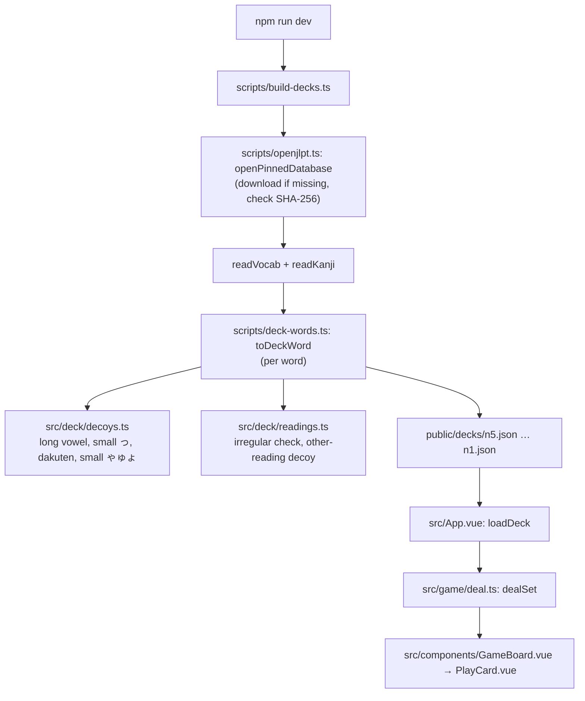

# juku-arcade: a guide to the code

For anyone reading the code for the first time. It covers what happens when
you run the game, the words the code uses, and where to change things.
Keep it in step with the code: a PR that makes it wrong fixes it.

## The flow: from `npm run dev` to a dealt board

1. **`npm run dev`** runs the deck build, then starts Vite.
2. **`scripts/openjlpt.ts: openPinnedDatabase`** finds `data/raw/openjlpt.sqlite`,
   downloading it from the pinned OpenJLPT commit if it's missing. It
   refuses to go on if the file's SHA-256 isn't the pinned one, because
   different data would make different decks.
3. **`readVocab`** and **`readKanji`** read the words (7,811) and kanji
   (2,383) out of SQLite with Node's built-in `node:sqlite`.
4. **`scripts/deck-words.ts: toDeckWord`** turns each word into a deck word:
   - kana-only words (これ) are dropped, because their reading is their
     spelling;
   - **`decoysFor`** builds one decoy per error type, using
     `src/deck/decoys.ts` and `src/deck/readings.ts: otherReadingDecoy`;
   - **`missChanceGuess`** gives the starting difficulty guess, using
     `readings.ts: isIrregularReading`.
5. **`scripts/build-decks.ts`** writes one JSON file per JLPT level to
   `public/decks/`. These files aren't committed.
6. In the browser, **`src/App.vue: loadDeck`** fetches `decks/n5.json`.
7. **`src/game/deal.ts: dealSet`** picks 5 words that share no spelling
   and no valid reading, adds their readings, adds one decoy that isn't
   any word's valid reading, and shuffles the readings.
8. **`GameBoard.vue`** shows the 5 word cards over the 6 reading cards,
   each one a **`PlayCard.vue`**.

## Glossary

| Term | Meaning | Where |
|---|---|---|
| **Reading** | How a word is pronounced, written in kana: 学校 → がっこう | `DeckWord.reading` |
| **On-yomi / kun-yomi** | A kanji's Chinese-derived readings (ガク, shown in katakana) and native Japanese readings (まな.ぶ) | `KanjiReadings` in `readings.ts` |
| **Okurigana** | Kana written after a kanji as part of the word: the ぶ in 学ぶ. KANJIDIC2 marks it with a dot: まな.ぶ | `kunyomiForms` |
| **Stem form** | A verb's form inside compounds: 入る → 入り, in 入口 いりぐち | `STEM_FORM` in `readings.ts` |
| **Rendaku** | A sound that voices at the start of a compound's second part: 口 くち → 入口 いり**ぐ**ち | `withSoundChanges` |
| **Sokuon** | A small っ that doubles the next sound: 学 がく + 校 こう → が**っ**こう | `withSoundChanges`, `isPronounceable` |
| **Irregular reading** | A reading no combination of the kanji's readings makes, as in 今日 きょう or 大人 おとな. It feeds the difficulty guess | `isIrregularReading` |
| **Decoy** | The sixth reading card, which belongs to no word in the set. It's built to test one error type | `ReadingCard` with `wordId: null` |
| **Error type** | The kind of mistake a decoy tests: long vowel, small っ, dakuten, small ゃゅょ, other reading of the same kanji | `DECOY_TYPES` in `types.ts` |
| **Set** | One board: 5 words and 6 readings | `DealtSet` in `deal.ts` |
| **L2 rules** | No two cards in a set share a spelling or a valid reading, and the decoy is no word's valid reading | `canJoin`, `pickDecoy` |
| **Miss-chance guess** | The starting guess at how likely a word is to be missed, 0 to 1, before any play data | `missChanceGuess` |
| **Pinned OpenJLPT** | One exact OpenJLPT build, fixed by commit and SHA-256, the same one Juku uses | `scripts/openjlpt.ts` |

## Where to change things

- **Add or change an error type:** add a generator to `src/deck/decoys.ts`,
  add the type to `DECOY_TYPES` in `src/deck/types.ts`, wire it into
  `decoysFor` in `scripts/deck-words.ts`, and add a test.
- **Change the difficulty guess:** edit `DIFFICULTY_GUESS` in
  `scripts/deck-words.ts`.
- **Move to a newer OpenJLPT build:** change `OPENJLPT_COMMIT` and
  `SQLITE_SHA256` in `scripts/openjlpt.ts`, run `npm run decks:report`,
  and compare it with `docs/spikes/slice-0-decks.md`.
- **Change what a deck file holds:** edit `DeckWord` in
  `src/deck/types.ts`. The script and the game both follow it.
- **Change the set rules:** edit `src/game/deal.ts`, and its specs in
  `tests/deal.test.ts`.
- **Change how cards look:** edit `src/components/PlayCard.vue`. Every card
  is one.
